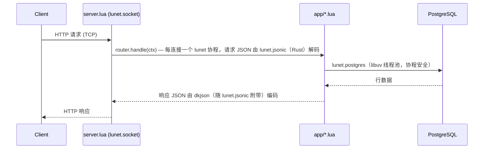

# 

> 遵循 [RealWorld](https://github.com/realworld-apps/realworld) 规范与 API 的 Lua 代码库，包含真实世界的示例（CRUD、认证、进阶模式等）。

### [演示](https://demo.realworld.build/)&nbsp;&nbsp;&nbsp;&nbsp;[RealWorld](https://github.com/realworld-apps/realworld)

后端 API 基于 **[lunet](https://github.com/lua-lunet/lunet)**（libuv + LuaJIT 协程运行时）与 **PostgreSQL** 构建：CRUD、JWT 认证、通过小型手写路由器路由。通过 RealWorld API 兼容性测试套件（`specs/run-api-tests-hurl.sh`）。

## 工作原理



- **lunet**：独立的 libuv + LuaJIT 运行时；`server.lua` 使用 `lunet.socket` 运行自己的 accept 循环，每连接一个协程
- **lunet.postgres**：基于 libpq 的 PostgreSQL 驱动；查询运行在 libuv 线程池上，慢查询不会阻塞事件循环
- **lunet.sodium / lunet.security**：通过发布自带的 crypto cdylib 调用 libsodium 原语 —— Argon2id 密码哈希（[app/password.lua](app/password.lua)）、CSPRNG、HS256 JWT 编码/校验
- **lunet.jsonic**：请求 JSON 由 Rust jsonic 解析器解码；响应 JSON 由附带的 dkjson 编码（见 [归属](#attribution)）
- **lunet.lnt_shared**：分片进程内字典，带原子计数器 —— 支撑 `/health` 上的请求指标（[app/metrics.lua](app/metrics.lua)）
- **lunet.http_router**：带 `:param` 提取的路由表 —— 并发协程下安全
- **lunet.http**：基于原始 socket 的请求/响应（反）序列化
- **lunet.http_context**：小型原生 Lua 请求/响应表（`method`、`headers`、`status`、`write`）；它取代了早期的 `ngx` 形状兼容层，而非提供 OpenResty 运行时。

## 资源占用

与另外两个 RealWorld 示例应用（Node.js 与 Python/Django）对比测量：

| 指标 | Lunet | Node.js | Python/Django |
|------|-------|---------|---------------|
| Docker 镜像 | 196 MB | ~450 MB | ~400 MB |
| 运行时内存 | 空闲 6.2 MB，预热 11.6 MB | ~50 MB | ~80 MB |
| 冷启动 | 29 ms | ~500 ms | ~1 s |

Lunet 提供 Node.js 级别的异步 I/O 能力，同时具备原生代码的资源效率。

Lunet 列的测量上下文：macOS arm64，colima（Virtualization.Framework），lunet v0.17.3，PostgreSQL 16（Docker Compose）。Docker 镜像：`linux/arm64` 的 `make docker-build` 变体。运行时内存：容器内服务器进程的 `VmRSS`，空闲及 `hey -z 5s -c 16 /api/articles` 突发后（5,089 请求，全部 200；空闲稳定后）。冷启动：启动 → `/health` 200，主机原生（通过 `docker run` 同一检查为 121 ms，那是容器编排开销，而非应用启动）。

## 十分钟垂直切片

完成 [快速开始](#getting-started) 后，把这两个 Hurl 文件读作一段小旅程：[`specs/hurl/auth.hurl`](specs/hurl/auth.hurl) 注册用户并登录；[`specs/hurl/articles.hurl`](specs/hurl/articles.hurl) 创建并列出该用户的文章。

1. **第 0–2 分钟 — 注册。** Hurl 发送 `POST /api/users`。`server.lua` 读取一个请求，`app/router.lua` 选择认证处理器，处理器解码并校验 JSON，`app/db.lua` 执行参数化 SQL，路由器编码响应供 Hurl 断言。
2. **第 2–4 分钟 — 登录。** `POST /api/users/login` 走相同路径，增加密码校验与 JWT 创建；Hurl 捕获 token 供下个请求使用。
3. **第 4–7 分钟 — 创建文章。** `POST /api/articles` 校验 token，校验 title/description/body/tags，然后使用显式数据库事务创建文章及其标签，再序列化文章。
4. **第 7–10 分钟 — 列出。** `GET /api/articles` 路由到列表处理器，从 PostgreSQL 取行，把每篇文章格式化为 API 形状，Hurl 检查结果列表。在转向其他端点前，先跟随这些调用阅读命名文件。

## 有意的限制与权衡

- HTTP 解析器仅支持 HTTP/1.1 的小子集：每个连接一个 origin-form 请求、CRLF 头部、每字段单值、可选的十进制 `Content-Length`。拒绝 `Transfer-Encoding`，包括分块正文。
- 每个响应都关闭连接。无持久连接或请求管线；这使 socket 处理可见，但并非面向吞吐量。
- PostgreSQL 连接有硬上限（默认 40，`PGPOOL_MAX`），涵盖空闲、借出与正在打开的连接 —— 低于服务器的 `max_connections`，上限绝不能超过它。达到上限时，请求协程协作等待释放；这是有界的池压力，而非快速过载响应。
- 事务是显式回调块，把工作固定在单个借出的连接上，作为整体提交或回滚。普通查询单独借出并释放连接，因此多步写入必须显式选择事务。
- 文章展示有意对每篇文章做额外查询取标签，以及认证时的收藏/关注状态。这暴露了塑形工作，但属于 N+1 查询模式，对大结果页扩展性不佳。
- 选择 PostgreSQL 是为了把关系型 SQL、约束与事务保持在视图中。这也意味着需要本地 PostgreSQL 服务与凭据；这不是嵌入式数据库示例。
- 无负载卸载。持续过载下，服务器与等待的数据库协程会排队工作，而非主动返回 `503`。

## 项目结构

```
├── Makefile               # init, start, stop, test, lint, clean
├── server.lua              # 入口：lunet accept 循环，分派到 router
├── index.html               # 落地页
├── app/
│   ├── routes.lua          # 路由注册
│   ├── auth_routes.lua     # /api/users, /api/user
│   ├── article_routes.lua  # /api/articles, comments, favorites, tags
│   ├── profile_routes.lua  # /api/profiles
│   ├── web.lua             # 共享助手（auth token 解析、响应）
│   ├── db.lua              # 通过 lunet.postgres 的 SQL 查询
│   ├── password.lua        # 通过 lunet.sodium 的 Argon2id 哈希
│   ├── metrics.lua         # 通过 lunet.lnt_shared 的请求计数器，暴露于 /health
│   ├── config.lua          # 环境变量解析
│   ├── response.lua        # 路由器响应形状
│   └── dotenv.lua          # .env 文件加载器
├── nginx.conf                # nginx 前端：静态、gzip、/api 代理（可选；make frontend）
├── frontend/                 # 获取的前端 docroot（gitignored；make frontend）
├── scripts/
│   ├── lunet_fetch_release_v0.17.3.lua # 获取 lunet 发布到 .lunet/
│   ├── frontend.sh           # 获取预构建前端到 frontend/
│   └── bundle.sh             # 将发布 + 应用重新打包为自解压 .run
├── .lunet/                  # lunet 二进制与类型（gitignored；make deps 创建）
├── dist/                    # 自解压应用包（gitignored；make bundle）
├── sql/schema.sql          # PostgreSQL schema
├── specs/                  # RealWorld Hurl 兼容套件 + OpenAPI 规范
└── target/                 # 运行时文件：pid、日志、本地 Postgres 数据目录（gitignored）
```

运行时状态（pid、日志）位于 `target/`；`make clean` 清空它（服务器运行时拒绝）。

## 快速开始

一次性 Compose 路径需要 Docker 与 PostgreSQL 客户端（`psql`）；[mise](https://mise.jdx.dev/) 提供 hurl 与 lua-language-server。

```bash
cp .env.example .env   # PGHOST, PGPORT, PGDATABASE, PGUSER, PGPASSWORD, JWT_SECRET

make dev       # 启动一次性 PostgreSQL，加载 sql/schema.sql，启动 API
make seed      # 创建 demo@example.com / demo-password 与一篇演示文章
make test      # 运行 RealWorld API 兼容性套件（Hurl）
make load-test # 以 hey 进行读主导负载测试，并发倍增 1 -> 64
make lint      # lua-language-server 静态分析
make stop      # 停止服务器
make clean     # 删除 target/ 中的运行时文件
make bundle    # 将发布 + 应用重新打包为自解压 dist/*.run
```

`make db-down` 删除 Compose 容器及其数据库卷。要改用现有 PostgreSQL 实例，跳过 `make db-up`，在 `.env` 中设置连接值，然后运行 `make init` 与 `make start`。

## API 文档

本地 OpenAPI 服务器为 `http://localhost:8081/api`。运行 `make api-docs` 并打开 <http://localhost:8082/> 在 Swagger UI 中浏览 `specs/openapi.yml`；完成后运行 `make api-docs-stop`。

## 二进制依赖（`.lunet/`）

`make deps` 运行 `scripts/lunet_fetch_release_v0.17.3.lua`，从 [lunet releases](https://github.com/lua-lunet/lunet/releases) 下载并安装标记的 `v0.17.3` 发布到 `.lunet/v0.17.3/`。获取器校验归档 SHA-256 与发布元数据，原子安装到暂存目录，并且幂等：

- `lunet-run` + `lunet.so`
- 驱动 `lunet/{postgres,mysql,httpc,sqlite3,paxe}.so`
- `lunet/{lnt_shared,jsonic,paxe,postgres_tx,mysql_tx,sqlite3_tx}.lua` + C 库
- `types/` LuaCATS 注解（`.luarc.json` 引用此目录以驱动 `make lint`）与 Teal `.d.tl` 定义

`lunet-run` 把自身目录前置到 `package.path` 与 `package.cpath`，因此所有 lunet 模块无需应用侧配置即可解析。主机 Lua 解释器（5.1+、LuaJIT 或通过 `mise`）仅在运行获取器脚本时需要。

运行时共享库：

- **macOS**：`brew install luajit libuv libpq libsodium zlib`
- **Debian/Ubuntu**：`apt install libluajit-5.1-2 libuv1 libpq5 libsodium23 libsqlite3-0`
  以及用于 FFI 的无版本 `libsodium.so` 符号链接（在 [Dockerfile](Dockerfile) 中创建）。

## Docker

```bash
make docker-build
docker run --rm -p 8081:8081 --env-file .env realworld-lua
```

镜像目标为 `linux/amd64`（上游还发布 `linux-arm64` 与 `windows-amd64`）。

## 可选：nginx 后的前端（不属于演示）

`make frontend` 获取预构建前端到 `frontend/`，并通过 nginx（[nginx.conf](nginx.conf)）提供服务 —— gzip、缓存头、SPA 回退、`/api/*` 反向代理到 `:8081` 后端：

```bash
make frontend       # 获取前端（首次运行），在 :8083 提供服务
make frontend-stop
```

需要 `PATH` 上的 nginx（macOS 用 `brew install nginx`）。打开 <http://localhost:8083/>。页面通过代理同源调用 API。端口覆盖，若任一默认端口冲突：`make frontend FRONTEND_PORT=18443 BACKEND_PORT=8084`。

- [scripts/frontend.sh](scripts/frontend.sh) 获取固定的前端（见 [归属](#attribution)）并打补丁：API base → `/api`；死掉的主题 CDN 链接 → 附带的经典 Conduit CSS。
- `nginx.conf` 提供静态前端并把 `/api/` 代理到后端。高端口的演示级默认；生产环境请适配到站点配置而非原样运行。
- 通过前端运行 Hurl 套件：`HOST=http://localhost:8083 bash specs/run-api-tests-hurl.sh`

## vanilla-pod-js 前端（已测量）

[](vanilla-pod-js/README.md)
[](vanilla-pod-js/README.md)
[](vanilla-pod-js/README.md)

[vanilla-pod-js/](vanilla-pod-js/) 是第二个前端选项：完整的 Conduit RealWorld UI，框架无关、无打包器的原生 JavaScript —— light-DOM web components、API 边界处 JTD 校验的冻结数据、零运行时依赖、无构建步骤。使用 `./scripts/frontend-vanilla-pod.sh` 安装，然后用 `make frontend`（nginx，[nginx.conf](nginx.conf)）提供服务。

测量于 macOS arm64，lunet v0.17.3，PostgreSQL 16，浏览器页面加载的首页资源闭包（16 个文件：HTML + 主题 CSS + 所有 ES 模块）：

| 指标 | 值 |
|------|----|
| 前端，首页资源闭包，原始 | 114 kB（114,170 字节） |
| 前端，首页资源闭包，服务时 gzip | 23.4 kB（23,949 字节） |
| 首次绘制前的构建步骤 | 0（无打包器、无转译器） |
| lunet 后端冷启动（启动 → `/health` 200） | 29 ms |
| lunet 后端空闲 RSS | 11.0 MB |
| lunet 后端 3,000 请求突发后 RSS（16 并发） | ~25 MB |
| 读吞吐量（5 s，16 并发，`hey`） | ~4,400 请求/s 列表，~6,600 请求/s 详情 |

该前端的浏览器奇偶性已对真实 lunet 后端端到端验证：注册、登录、全局 feed、标签过滤、文章页、评论、收藏切换、关注切换、个人页（文章 + 收藏）、设置保存、编辑器（创建文章）。

## 归属

后端按 [MIT](LICENSE) 授权。第三方素材：

在 `.lunet/v0.17.3/`（均属 lunet 发布归档的一部分）：

- **dkjson**（`.lunet/v0.17.3/lunet/dkjson-encode-v2.10.lua`）—— Lua 的 JSON 编解码，作者 David Kolf，[MIT](http://dkolf.de/dkjson-lua)。`lunet.jsonic` 的编码一半。
- **jsonic**（`.lunet/v0.17.3/lunet/jsonic.lua` + `.lunet/v0.17.3/lunet/liblunet_jsonic.*`）—— 快速 JSON 解析器（[jsonic](https://github.com/g1mv/jsonic)，MIT/Apache-2.0），位于 lunet 的 FFI 绑定之后；解码一半。许可证文本：[lunet `ext/jsonic/`](https://github.com/lua-lunet/lunet/tree/v0.17.3/ext/jsonic)。

在 `frontend/`（可选，未提交）：

- **[daodao-bot/realworld-html-js-simple](https://github.com/daodao-bot/realworld-html-js-simple)** ——
  原生 HTML/JS RealWorld 前端，固定提交 `cac2d502`，[Unlicense](https://unlicense.org)；
  其 `LICENSE` 随之获取。如上应用两项获取时补丁。
- **Conduit 演示主题**（`main.css`）—— 代码与设计来自
  [RealWorld](https://github.com/realworld-apps/realworld) 演示（MIT）；打包 Bootstrap v4
  （MIT，© Twitter, Inc.）。原始 CDN 已失效；从
  [Wayback Machine 快照](https://web.archive.org/web/20250708043359/https://demo.productionready.io/main.css) 附带。
- **图标/字体** 在浏览器中从 CDN 加载：[Ionicons](https://ionicons.com)（MIT）、
  Google Fonts（SIL OFL 1.1）。

RealWorld 名称与 API 规范：[RealWorld](https://github.com/realworld-apps/realworld)（MIT）。

## 负载测试

`make load-test` 运行 [specs/run-load-tests.sh](specs/run-load-tests.sh)（需要
[hey](https://github.com/rakyll/hey)）：读重混合（~99% 读）并发倍增 1 → 64；任何 HTTP 500 即失败。`server.lua` 无负载卸载 —— 持续过载下它会排队而非返回 `503`。

## 许可证

[MIT](LICENSE) —— 第三方组件按其各自许可证，见 [归属](#attribution)。

---

中文版 | [English](README.md)